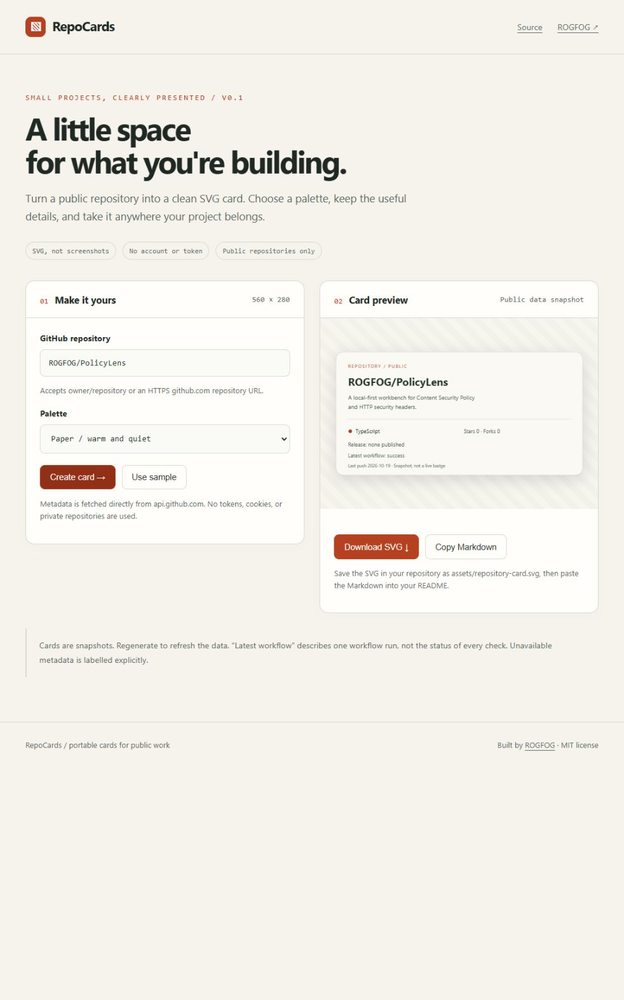

# RepoCards

Clean, portable SVG cards for public GitHub repositories. Enter a repository,
choose Paper or Night, and download a card for a README or project page.

[Open the card studio](https://rogfog.github.io/RepoCards/) · [Design notes, RU](docs/design.ru.md)



## Included

- Public name, description, language, stars, forks and last push date.
- Latest published release and latest workflow run, when accessible.
- Two palettes, accessible SVG titles, local preview and SVG download.
- Markdown snippet for a card saved as `assets/repository-card.svg`.
- Clearly labelled sample mode and explicit unavailable-data states.

Cards are **snapshots**, not hosted live badges. Latest workflow means one run,
not every check or the status of the current default branch. Regenerate a card
when you need to refresh its contents.

## Run locally

Requires Node.js 24+ and npm.

```sh
npm ci --ignore-scripts
npm test
npm run dev
```

Open http://127.0.0.1:4173. `npm run build` creates a static site in `dist/`.

## Privacy and rendering

Metadata requests go directly from your browser to api.github.com, with no
credentials or referrer. No tokens, accounts, proxy, analytics or persistent
storage. GitHub receives the public repository query and normal network metadata.
Unauthenticated API limits apply; rate-limit failures are displayed explicitly.

Only owner/repository identifiers and HTTPS github.com repository URLs are
accepted. Remote text is XML-escaped; cards contain no scripts, foreignObject,
remote images or fonts. The preview is parsed as SVG after escaping.

## Development

The renderer and request layer are independent of the DOM. Tests cover malicious
metadata, URL validation, optional metadata failures, API limits and palettes.
CI tests and builds PRs. Pages publishes tested builds from main.

See [open tasks](https://github.com/ROGFOG/RepoCards/issues) for the next steps.

MIT license.
